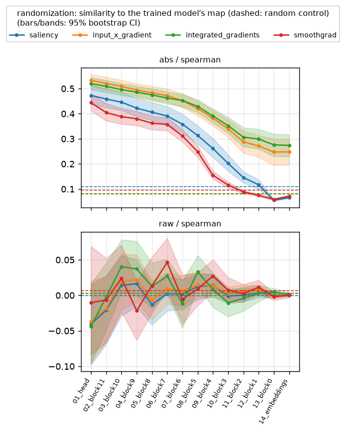
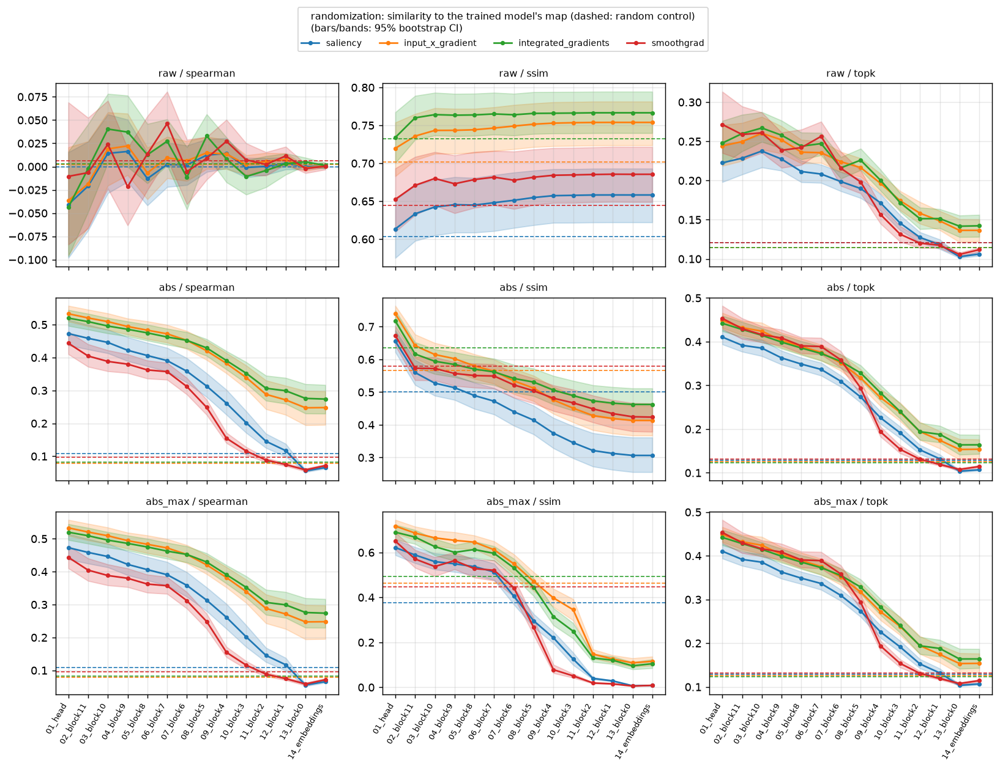
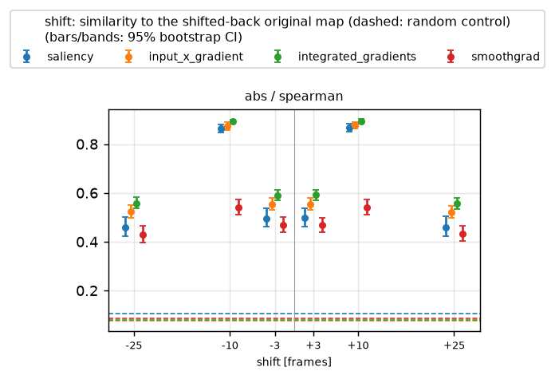
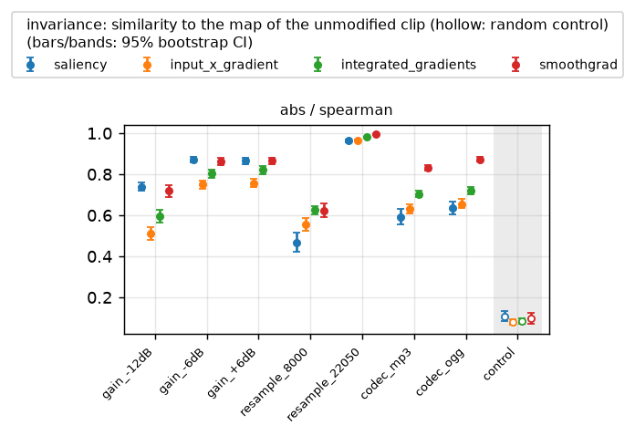
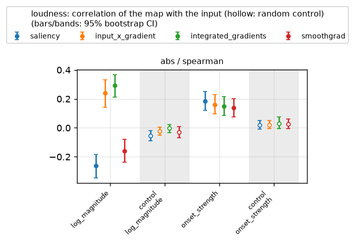
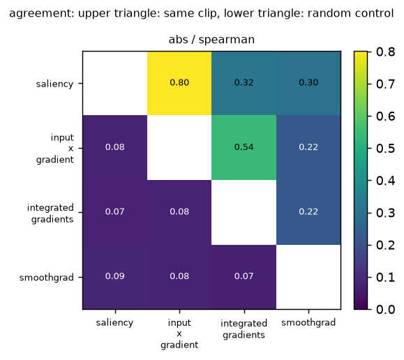

# 2026-11-15: wyniki pilota (AST + ESC-50)

Realizacja „First steps” z karty zadania: mapy dla 50 klipów, 4 metody, randomizacja kaskadowa
z normalizacją i bez, wykres, wynik obalający.

## Ustawienia

- **Model:** AST `MIT/ast-finetuned-audioset-10-10-0.4593` (tagger AudioSet, 527 klas).
- **Dane:** 50 losowych klipów ESC-50 (seed 0), okno 4 s ze środka klipu, 16 kHz.
  Wyjaśniana klasa to klasa o najwyższym wyniku modelu (średni wynik 0,56, mediana 0,61;
  predykcje są sensowne, np. `frog` → *Frog*, `clapping` → *Applause*).
- **Metody (Captum):** Saliency, Input × Gradient, Integrated Gradients (16 kroków,
  baseline = zero), SmoothGrad (16 próbek, szum 0,15).
- **Testy:** wszystkie pięć (randomizacja, przesunięcie, niezmienniczość, głośność, zgodność).
- **Czas:** ok. 2 h 20 min na RTX 5050 Laptop (8 GB).
- **Przebieg:** `results/pilot_ast_esc50_20261113_130246/` (lokalnie, poza gitem);
  config: `configs/pilot.yaml`.

Liczby poniżej to średnia korelacja Spearmana z 95% przedziałem bootstrap. **Kontrola** to
podobieństwo map dwóch *różnych* klipów, czyli poziom przypadku (ok. 0,08–0,11).

## Randomizacja kaskadowa

| metoda | po losowaniu głowicy | po losowaniu całego modelu | kontrola |
|---|---|---|---|
| Saliency | 0,47 [0,44; 0,52] | **0,07** [0,06; 0,07] | 0,11 |
| SmoothGrad | 0,44 [0,41; 0,48] | **0,07** [0,07; 0,08] | 0,10 |
| Input × Gradient | 0,53 [0,51; 0,56] | **0,25** [0,20; 0,30] | 0,08 |
| Integrated Gradients | 0,52 [0,50; 0,54] | **0,27** [0,23; 0,32] | 0,08 |

(normalizacja `abs`; `abs_max` daje przy Spearmanie te same liczby, bo korelacja rangowa nie
zależy od skali)

- **Saliency i SmoothGrad przechodzą:** po zrandomizowaniu modelu ich mapy spadają do poziomu
  kontroli.
- **IxG i IG oblewają:** nawet z całkowicie losowym modelem ich mapy są ok. 3 razy bardziej
  podobne do oryginału niż mapy dwóch różnych klipów. Część mapy pochodzi z wejścia (oba mnożą
  przez wejście), a nie z wag modelu. **To samo pokazał Adebayo i in. (2018) w wizji.**
- **Bez normalizacji (`raw`, mapy ze znakiem) werdykt jest inny:** wszystkie metody spadają do
  zera (−0,04 [−0,10; 0,02]) już po zrandomizowaniu samej głowicy. Losowa głowica odwraca znak
  gradientu, więc na mapach ze znakiem wszystko „przechodzi”. Adebayo i in. (2018) widzieli
  to samo dla IxG i IG (Spearman ze znakiem spada do zera, na wartościach bezwzględnych nie),
  a karta ostrzega przed tym wprost: werdykt zależy od normalizacji, więc trzeba raportować
  obie wersje.
- **Wzór „z mnożnikiem wejścia oblewa, bez mnożnika przechodzi”** to dokładnie obserwacja
  Kokhlikyana i in. (2021) dla obrazów. Na tekście tego efektu nie widzieli; audio (przynajmniej
  na AST) zachowuje się tu jak obrazy.

### Czy werdykt zależy od miary podobieństwa?

Ten sam przebieg dla trzech normalizacji (wiersze) i trzech miar (kolumny). Pełna siatka,
z Pearsonem, jest w `results/.../figures/randomization_all.png`.

- **Spearman i Pearson** dają ten sam werdykt: IxG i IG po pełnej randomizacji zostają powyżej
  kontroli (Pearson, `abs`: IG 0,12 wobec 0,03), Saliency i SmoothGrad schodzą do niej.
- **Top-k** daje ten sam kierunek, ale słabszy: IG 0,16 wobec kontroli 0,12.
- **SSIM zachowuje się zupełnie inaczej.** Na mapach `raw` prawie się nie zmienia i zostaje
  powyżej kontroli dla wszystkich metod (wszystko by „oblało”). Na `abs_max` wszystkie metody
  spadają *poniżej* kontroli (wszystko by „przeszło”). Do tego kontrola dla SSIM jest bardzo
  wysoka (0,4–0,7), czyli mapy dwóch różnych klipów wyglądają dla SSIM podobnie.

Wniosek: werdykt zależy nie tylko od normalizacji, ale i od miary, a SSIM na naszych mapach
wydaje się mało wiarygodny. To konkretny kandydat do sprawdzenia w meta-ewaluacji miar
(tydzień 6). Na razie traktujemy Spearmana na `abs` jako miarę główną.

## Wynik obalający

Hipoteza obalająca: *wszystkie metody przechodzą wszystkie testy na
wszystkich modelach w granicach szumu próby kontrolnej.*

**Pilot jej nie potwierdza.** Już na jednym modelu dwie z czterech metod (IxG, IG) oblewają
randomizację: ich przedziały ufności po pełnej randomizacji (0,20–0,32) nie nachodzą na
przedziały kontroli (0,07–0,10). Projekt ma więc sens. Zastrzeżenie: „oblewa” oceniamy na razie
na oko (brak przedziału kontroli w przedziale wyniku); formalna reguła pass/fail jest jeszcze
do zrobienia.

## Pozostałe testy (pierwsze obserwacje)

Jak czytać wykresy: kropki to średnie z 95% przedziałem ufności, puste kropki i szare pola
(albo linie przerywane) to kontrola, czyli podobieństwo map dwóch różnych klipów. Wszystkie
wykresy: normalizacja `abs`, miara Spearman.

**Przesunięcie: wynik zależy od budowy AST.**

Przy przesunięciu o ±10 ramek mapy przesuwają się prawie idealnie (Saliency 0,87, IG 0,89),
a przy ±3 i ±25 ramkach spadają do 0,46–0,59. AST tnie spektrogram na łatki co 10 ramek
(`time_stride: 10`, czyli 100 ms), więc mapa jest ekwiwariantna tylko dla przesunięć
o wielokrotność tego kroku. Predykcja zmienia się przy tym mało (o 0,02–0,05). Do sprawdzenia
w pełnej siatce: przesunięcia ±20 i ±30.

**Niezmienniczość: mapy zmieniają się bardziej niż predykcje.**

Resampling przez 22 050 Hz,
który praktycznie nic nie zmienia, daje 0,96–0,99, co potwierdza, że pipeline działa. Gain −6 dB
daje 0,75–0,87, MP3 0,59–0,83, a resampling przez 8 kHz 0,47–0,63, przy zmianie predykcji
o 0,05–0,08. Wszystkie wyniki są daleko nad kontrolą, więc mapy się nie „rozsypują”, ale też
nie są stabilne. Najsilniej mapy zmienia gain −12 dB (IxG 0,51), najodporniejszy na kodeki jest
SmoothGrad (0,83–0,87). Gain działa niesymetrycznie: −6 dB i +6 dB dają podobne wyniki, a −12 dB
wyraźnie gorsze. Bez reguły pass/fail nie wiadomo jeszcze, gdzie jest granica oblania.

**Głośność: umiarkowana.**

Mapy IxG i IG korelują z log-spektrogramem (0,24 i 0,29), Saliency
i SmoothGrad ujemnie (−0,26 i −0,16, czyli mocniejsze gradienty w cichych miejscach).
Korelacja z onsetami to 0,14–0,18 przy kontroli ok. 0,02. Metody z mnożnikiem wejścia (IxG,
IG) idą więc za głośnością, a czyste gradienty odwrotnie; wszystkie lekko reagują na początki
dźwięków.

**Zgodność: metody nie zgadzają się co do znaku.**

Górny trójkąt to zgodność dwóch metod na tym samym klipie, dolny to kontrola (różne klipy,
0,07–0,09). Najbardziej zgodne są Saliency i IxG (0,80), potem IxG i IG (0,54). SmoothGrad
odstaje od wszystkich (0,22–0,30), mimo że to uśredniony Saliency. Na mapach ze znakiem
zgodność Saliency i IxG spada do −0,11: wskazują te same miejsca, ale z przeciwnym kierunkiem
wpływu. To problem opisany przez Krishnę i in. (2022).

## Ograniczenia

- Jeden model (AST); detektor SONICS z „First steps” jeszcze nie jest podłączony. Przechodzi
  na tydzień 4.
- Metody pilota to same metody gradientowe. Docelowa piątka (Saliency, IG, Guided Backprop,
  LRP, Occlusion) zawiera dopiero metody, które w wizji oblewały najmocniej.
- Okna 4 s są dopełniane w AST do 10,24 s, więc ok. 60% wejścia to padding.
- Baseline IG = zero w znormalizowanym log-melu, czyli nie cisza. Od 15.11 można to zmienić
  parametrem `attribution.ig_baseline`.
- Pilot liczony przed dodaniem dokładnego testu Kindermansa i randomizacji niezależnej.
  W smoke teście (4 klipy) test Kindermansa daje Saliency 0,9999 (przechodzi) i IG z baseline =
  zero 0,61 (oblewa), zgodnie z pracą.

## Następne kroki

- Reguła pass/fail (sparowany bootstrap różnicy wynik − kontrola).
- Detektor SONICS i PANNs, Guided Backprop i Occlusion.
- Powtórzenie pilota z docelowymi metodami i `ig_baseline=silence`.
